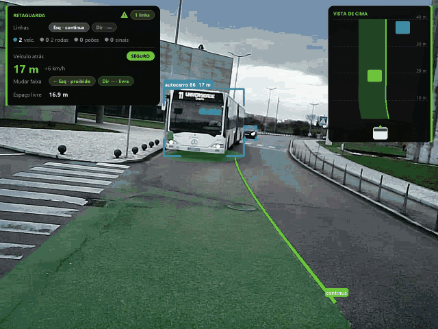
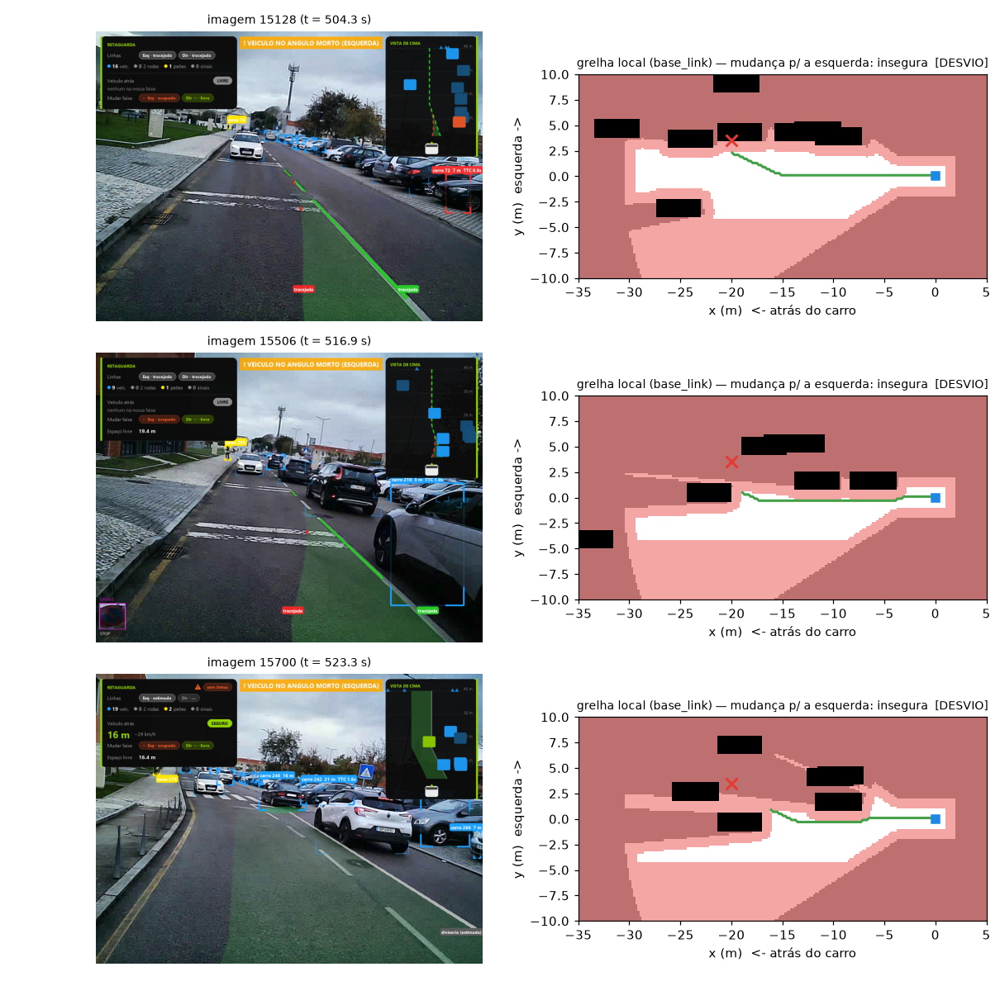

# VA 2026/2027 · Grupo 06 · Perceção visual traseira do ATLASCAR2

Câmara traseira Orbbec Astra Pro no ATLASCAR2: deteção e seguimento de veículos, duas rodas e
peões, linhas da faixa e marcações, sinais portugueses, distância e tempo até à colisão,
avisos de segurança, **grelha de ocupação local** atrás do carro e planeamento local (A*) para
avaliar a mudança de faixa.



📄 **Plano de projeto (PDF):** [`docs/plano_de_projeto_G6.pdf`](docs/plano_de_projeto_G6.pdf)

| | |
|---|---|
| **Sensor** | Orbbec Astra Pro (RGB-D), USB; cor 1280×720 a 15 fps (`usb_cam`), profundidade pelo driver Orbbec |
| **Posição no carro** | `camera_tras_link`, traseira, a olhar para trás: x = −0,50 m, y = 0, z = 1,10 m, yaw = π em relação ao `base_link` (valores provisórios em `.env`, a medir no carro) |
| **Driver ROS 2** | `ros-jazzy-usb-cam` (cor); `OrbbecSDK_ROS2` (profundidade, imagem `Dockerfile.rgbd`) |
| **Saídas** | `/g06/grelha_local`, `/g06/caminho_local`, `/g06/estado`, `/g06/zona_proibida`, `/g06/percecao/*`, `/g06/reacao/*` |
| **Equipa** | João Tomás (119137), Tomás Frade (113507) |

## Arquitetura

```
câmara (real | simulada | bag) --image_raw/compressed--> percecao --grelha_local--> planeador (A*)
          + URDF (/tf_static)                              |  \--percecao/seguranca, agentes--> reacao
                                                           +--> imagem anotada, marcadores (rviz/Foxglove)
```

| Serviço (compose) | Nó | Subscreve | Publica |
|---|---|---|---|
| `camera` (profile `sensor`) | `usb_cam` + `robot_state_publisher` | — | `/atlascar2/camera_tras/image_raw/compressed` (sensor_msgs/CompressedImage), `/atlascar2/camera_tras/camera_info`, `/tf_static` |
| `simulador` (profile `simulado`) | `camara_simulada` + `robot_state_publisher` | — | os mesmos tópicos da câmara real (vídeo de `data/` ou estrada sintética) |
| `reprodutor` (profile `reproduzir`) | `ros2 bag play` | — | os tópicos do bag (`TOPICOS` no `.env`) |
| `percecao` | `percecao`, `reacao` (pacote `va_g06`) | `/atlascar2/camera_tras/image_raw/compressed`, `/tf_static`, `/atlascar2/velocidade`, `/atlascar2/pisca`, `/atlascar2/marcha_atras` | `/g06/grelha_local` (nav_msgs/OccupancyGrid) e os tópicos da tabela seguinte |
| `planeador` | `local_astar` (`va_planeamento`, comum) | `/g06/grelha_local` | `/g06/caminho_local` (nav_msgs/Path), `/g06/estado` (std_msgs/String), `/g06/zona_proibida` |

### Tópicos

| Tópico | Tipo | frame_id | Frequência | Conteúdo |
|---|---|---|---|---|
| `/atlascar2/camera_tras/image_raw/compressed` | sensor_msgs/CompressedImage | `camera_tras_optical_frame` | 15 Hz | imagem da câmara (é a que se grava) |
| `/g06/grelha_local` | nav_msgs/OccupancyGrid | `base_link` | a do processamento | grelha atrás do carro (ver abaixo) |
| `/g06/percecao/agentes` | va_percecao_msgs/Agentes | `camera_tras_optical_frame` | idem | veículos, duas rodas, peões e sinais: ID, distância, faixa (lado do carro), TTC |
| `/g06/percecao/deteccoes` | vision_msgs/Detection2DArray | idem | idem | as mesmas caixas em tipos normalizados |
| `/g06/percecao/pavimento` | va_percecao_msgs/Pavimento | idem | idem | linhas da faixa + tipo, passadeiras, linhas de paragem |
| `/g06/percecao/seguranca` | va_percecao_msgs/EstadoSeguranca | idem | idem | veículo atrás (distância, TTC), mudar de faixa, espaço livre, avisos |
| `/g06/percecao/marcadores` | visualization_msgs/MarkerArray | `camera_tras_link` | idem | agentes em 3D (rviz/Foxglove) |
| `/g06/percecao/imagem_anotada/compressed` | sensor_msgs/CompressedImage | `camera_tras_optical_frame` | idem (só se alguém subscrever) | imagem com o painel e as caixas |
| `/g06/reacao/acao` | va_percecao_msgs/Acao | idem | idem | nível + comandos (`LIGAR_QUATRO_PISCAS`, `NAO_MUDAR_ESQUERDA`, `PARAR_MARCHA_ATRAS`, …) |
| `/g06/reacao/aviso` | std_msgs/String | — | quando muda | texto para o condutor |

O driver publica com QoS *best effort* (sensor data) e o nó de perceção subscreve com o mesmo
perfil. A perceção trata sempre a imagem **mais recente**: se o modelo for mais lento do que a
câmara, salta imagens em vez de acumular atraso.

### Grelha local (contrato da aula 10)

`/g06/grelha_local`, no `base_link`, com o `header.stamp` da imagem que lhe deu origem;
0,2 m por célula, **x de −35 a 5 m** (a câmara vê para trás), y de −10 a 10 m.

| Valor | O que é |
|---|---|
| **100 ocupado** | veículos, duas rodas e peões como caixas no chão (distância e posição lateral pelo modelo monocular de chão plano); linhas **contínuas** (não se podem atravessar) |
| **0 livre** | o chão visível: dentro do campo de visão (66°), desde a câmara até ao primeiro obstáculo ou 30 m; e o próprio carro + 3 m atrás dele |
| **−1 desconhecido** | o que está escondido atrás de um veículo, fora do campo de visão, longe demais, ou à frente do carro |

A pose da câmara vem do `/tf_static` (URDF); sem TF (p. ex. um bag sem `/tf_static`) usa-se a
pose por omissão do parâmetro `pose_camara_omissao`.

**Planeador e mudança de faixa.** Para a câmara traseira, o objetivo local do planeador é a
**faixa ao lado, 20 m atrás** (`objetivo_x: -20`, `objetivo_y: 3.5` = faixa da esquerda;
−3,5 = direita, em `src/va_g06/config/params.yaml`) e o corredor é a estrada (a nossa faixa e as
duas ao lado, |y| ≤ 5,25 m — sem isto o A* contornaria os carros pelo passeio, como na figura 2b
da aula). O que a câmara não vê (escondido atrás de um carro, fora do campo de visão) **não conta
como livre** (`desconhecido_livre: false`); só o próprio carro e os primeiros 3 m atrás dele (onde
um veículo apareceria cortado no fundo da imagem) ficam livres, para o caminho poder partir. O A*
comum procura a célula livre mais
próxima do objetivo: se o caminho **chega** à faixa pedida, a mudança é possível; se fica
noutra célula (veículo nessa faixa) ou o estado é `BLOQUEADO`, a mudança é insegura. (O estado
`DESVIO` aparece mesmo com a faixa livre, porque o caminho até um objetivo na diagonal é em
"escada" — o que conta é onde o caminho termina.) O nó de perceção publica também a decisão
direta em `/g06/percecao/seguranca` (`mudar_esquerda` / `mudar_direita`: livre, ocupado ou
proibido por linha contínua).

## Como correr

Requisitos: Docker (Ubuntu 24.04 com Docker Engine; Windows com Docker Desktop, sem sensores).

```bash
git clone https://github.com/frad3x/va-percecao-traseira-atlascar2 && cd va-percecao-traseira-atlascar2
docker compose build
docker compose --profile simulado up                        # sem sensor: câmara simulada
BAG=<pasta_em_data> docker compose --profile reproduzir up  # com um bag gravado
docker compose --profile sensor up                          # com a câmara ligada (Linux)
```

- **Windows** (PowerShell): `$env:COMPOSE_FILE = "compose.windows.yaml"` antes dos comandos acima.
- **Visualização**: `--profile foxglove` e, no Lichtblick/Foxglove, `ws://localhost:8765`
  (painel 3D com *Display frame* `base_link`: `/g06/grelha_local`, `/g06/zona_proibida`,
  `/g06/caminho_local`, `/g06/percecao/marcadores`; painel Image com
  `/g06/percecao/imagem_anotada/compressed`). Em Linux também `--profile rviz`.
- **Gravar** câmara + resultados em `data/`: juntar `--profile gravar` (nome `g06_camtras_<data>_<PERCURSO>`).
- **Câmara simulada com um vídeo**: `VIDEO_SIM=/data/videos_teste/<vídeo>.mp4` no `.env`; para um
  vídeo gravado lado a lado (RGB | profundidade) também `METADE_SIM=esquerda`.
- **GPU NVIDIA**: `docker compose -f compose.yaml -f compose.gpu.yaml ...` e, no `.env`,
  `MODELO=modelos/yolo11m.pt`, `IMGSZ=1280`.
- **Ver os valores ao vivo**: `docker compose exec percecao bash` e, lá dentro,
  `ros2 topic echo /g06/percecao/seguranca`, `ros2 topic echo /g06/estado`,
  `ros2 topic hz /g06/grelha_local`.
- **Desenvolver sem reconstruir**: abrir no VS Code com *Dev Containers* (pasta `.devcontainer/`),
  `colcon build --symlink-install` e lançar os nós à mão.

**Parâmetros que dependem do carro** (todos no `.env` ou em `src/va_g06/config/`):
- `video_device` e `pixel_format` em `src/va_g06/config/usb_cam.yaml` (descobrir com
  `v4l2-ctl --list-devices`; se não houver imagem, `pixel_format: yuyv` com 640×480);
- pose da câmara `CAM_X … CAM_YAW` no `.env` (vai para o URDF e para a grelha);
- `altura_camara` em `params.yaml` (= `CAM_Z`; dá a escala das distâncias);
- intrínsecos em `src/va_g06/config/camera_info.yaml` (opcionais: a perceção não precisa de
  calibração; servem para projetar outros sensores na imagem na parte 2). Calibrar com
  `ros2 run camera_calibration cameracalibrator --size 8x6 --square 0.025 --ros-args -r image:=/atlascar2/camera_tras/image_raw -r camera:=/atlascar2/camera_tras`.

**Profundidade (RGB-D).** A cor sai pelo `usb_cam`; a profundidade da Astra Pro só pelo driver
Orbbec, compilado numa imagem à parte: `docker compose --profile rgbd build camera_rgbd` e
`docker compose --profile rgbd up camera_rgbd` (pacote/launch do driver ajustáveis com
`ORBBEC_PKG` / `ORBBEC_LAUNCH`). Converter a profundidade de um bag em nuvens de pontos:
`python -m percecao.profundidade --fonte data/<bag> --saida_dir data/nuvens`.

## Dados

| Gravação (em `data/`) | Data | Conteúdo | Duração |
|---|---|---|---|
| `passeio_20261120_091854/` | 20/11/2026 | **volta real com o carro**: `viagem_lado_a_lado.avi` (Orbbec RGB à esquerda, profundidade à direita, 1280×480, 30 fps) + `telemetria.csv` (instante de cada imagem) | 23 min (41 804 imagens) |
| `g02_camtras_20261104_141343_percurso1/` | 04/11/2026 | bag MCAP de **teste** do código de aquisição (não é o percurso) | 2 158 imagens |
| `g02_camtras_20261104_160818_percurso1/` | 04/11/2026 | idem | — |
| `passeio_20261104_160353/` | 04/11/2026 | vídeo de **teste** lado a lado (RGB e profundidade) + `telemetria.csv` | 10 s (301 imagens) |
| `videos_teste/` | — | vídeos de câmaras traseiras usados para desenvolver o processamento | — |

Os bags e os vídeos **não estão no GitHub** (`data/` está no `.gitignore`): ficam no SSD do
grupo e no portátil; pedir aos autores.

## Resultados

Volta real de 20/11/2026 (`data/passeio_20261120_091854`, metade RGB): **20 902 imagens** a
15 fps (1 em cada 2 do vídeo de 30 fps, a taxa da câmara no carro), processadas a **13,2 imagens/s**
numa RTX 5060 portátil com o modelo preciso (YOLO11m a 1280 px + 3 modelos de sinais + linhas).
Figuras geradas com `python tools/figura_grelha.py data/passeio_20261120_091854/rgb_camara_traseira.mp4 --instantes 15128 15506 15700`.



| Grandeza (volta real) | Valor |
|---|---|
| Imagens com as 2 linhas da faixa / com pelo menos 1 | 41% / 85% (cidade: marcas gastas, cruzamentos, carros estacionados) |
| Veículos / peões / duas rodas por imagem (média) | 5,1 / 0,25 / 0,02 |
| Veículos seguidos que se **afastam** da câmara | 96% (1 211 de 1 263) — coerente com uma câmara traseira em marcha |
| Veículo atrás na nossa faixa | 16% do tempo (8% a distância segura, 8% perto); perigo (TTC ≤ 1 s) em 3% das imagens; TTC mínimo 0,3 s |
| Mudança de faixa possível (perceção) | esquerda 68%, direita 80% do tempo |
| Sinais reconhecidos (exemplos) | STOP, lomba (A2a), cedência (B1), trânsito proibido (C2), paragem e estacionamento proibidos (C16), limites 30/50/60, sentido proibido, rotunda, pista de velocípedes |


**Erros vistos ao rever o vídeo anotado** (a contagem dos sinais não foi validada com anotação):
um limite de **30** lido como 50 e um sinal de pista de **velocípedes** (D7a) lido como pista de
motociclos (D5c) — com 640×480 os sinais têm poucos píxeis; os avisos de **ângulo morto**
disparam muitas vezes com carros estacionados ao lado da via (33% das imagens com algum aviso).

## Limitações e trabalho futuro

- A distância é **monocular** (chão plano, horizonte estimado): serve para níveis de risco,
  não para medir com precisão; depende de `altura_camara` e da pose certa da câmara.
- A volta real foi gravada como vídeo (não como bag ROS): falta repetir a recolha com o
  `docker compose --profile sensor --profile gravar up` para ter o MCAP com `/tf_static`.
- O classificador dos sinais portugueses foi treinado com imagens sintéticas: em fotografias
  reais é mais fraco do que o GTSRB nos tipos comuns, por isso só decide nos sinais que o
  GTSRB não conhece (ver "Sinais").
- A grelha só cobre o que a câmara vê (atrás); a parte 2 junta-a às grelhas dos outros grupos.
- Os avisos de ângulo morto ainda não distinguem carros **estacionados** de carros em movimento
  (a velocidade relativa já é estimada; falta usá-la para ignorar os parados).
- A volta real é a 640×480 (gravação lado a lado): com a câmara a 1280×720 os sinais ao longe
  ficam com mais píxeis.

---

# Aplicação off-line (Windows/Linux, sem ROS nem Docker)

O mesmo núcleo de processamento (`percecao/pipeline.py`) corre fora do ROS, para analisar
gravações: vídeo, pasta de imagens ou rosbag MCAP → player, CSV e gráficos.

- **Janela**: duplo clique no atalho **"Perceção Traseira"** do ambiente de trabalho (ou
  `python -m percecao.gui`). Arrastas a gravação, escolhes as opções e carregas em **Analisar**.
  Criar o atalho noutro PC: `python\.venv\Scripts\python.exe tools\criar_atalho.py`.
- **`main.py`**: muda `FONTE` no bloco CONFIG e dá Run
  (`python/.venv/Scripts/python.exe main.py`).
- **Linha de comandos**: `python -m percecao data/<bag ou vídeo>` (`--help` para as opções;
  depois de `pip install ".[app]"` também `va-percecao`).

Um rosbag é convertido uma vez para `data/cache/<bag>.avi` (reutilizado depois). Cada análise
fica em `resultados/<gravação>_<data>/`: `deteccoes.csv`, `linhas.csv`, `seguranca.csv`,
gráficos e, se pedido, o vídeo anotado. Player: **ESPAÇO** play/pausa · **A/D** (←/→) ·
**+/−** velocidade · **HOME/END** · **G** guias de estacionamento · **V** vista de cima · **Q** sair.

## Estrutura do repositório

| Pasta / ficheiro | Papel |
|---|---|
| `Dockerfile`, `compose.yaml`, `compose.windows.yaml`, `compose.gpu.yaml`, `.env` | Imagem e serviços (modelo da aula 10) |
| `Dockerfile.rgbd` | Imagem da câmara RGB-D (driver Orbbec) |
| `src/va_planeamento/` | **Comum**: grelha local (`grid.py`) + A* (`astar.py`, `local_astar`) — copiado sem alterações |
| `src/va_g06/` | **Do grupo**: nós `percecao` (com a grelha), `reacao`, `camara_simulada`; launch; URDF da câmara; `config/params.yaml`, `usb_cam.yaml` |
| `src/va_percecao_msgs/` | Mensagens do grupo (`Agentes`, `Pavimento`, `EstadoSeguranca`, `Acao`, …) |
| `percecao/` | Núcleo Python (usado pelo nó e pela aplicação off-line): `pipeline`, `detecao`, `linhas`, `sinais*`, `aproximacao`, `seguranca`, `desenho`, `fontes`, `app`, `gui`, `player`, `percecao3d`, … |
| `main.py` | Aplicação off-line — basta dar Run |
| `modelos/` | Pesos: sinais (deteção GTSDB, 43 tipos GTSRB, 159 sinais PT) + YOLO base |
| `treino/` | Treino dos modelos de sinais (`treinar_sinais.py`, `sinais_pt.py`) |
| `tools/` | `figura_bag.py` (figuras a partir de um bag), `renomear_grupo.sh`, atalho da app, Argoverse |
| `docs/img/` | Figuras e GIF do README |
| `data/` | Bags e vídeos (volume `/data`; fora do GitHub) |
| `va_datasets/` | Datasets de treino (GTSDB, GTSRB, sinais PT) |
| `.github/workflows/ci.yml`, `.devcontainer/` | CI (constrói a imagem e corre os testes) e contentor de desenvolvimento |

# Perceção — métodos

## Linhas da faixa (`percecao/linhas.py`) — método da aula 5
Segue o exemplo *Visual Perception Using Monocular Camera* da aula 5, passo a passo, mas
**sem precisar de calibração**:

| Passo | Aula 5 | Aqui |
|---|---|---|
| Vista de cima | `birdsEyeView` | IPM com chão plano; horizonte **estimado sozinho** (ponto de fuga) |
| Marcas | `segmentLaneMarkerRidge` | ridge simétrico + contraste local (CLAHE) |
| Linhas | `findParabolicLaneBoundaries` | janelas deslizantes + **parábolas por RANSAC** |
| Rejeição | `validateBoundaryFcn`, `isOfMinLength`, força | curvatura no troço visível, comprimento mín., força ≥ 20% da maior |
| Tipo | `classifyLaneTypes` | **contínua / tracejada** pela cobertura da linha |
| Faixa do carro | `leftEgoBoundary` / `rightEgoBoundary` | linha mais próxima à esq. e à dir., com largura plausível |
| Dashboard (ex. 4b) | triângulos | **amarelo** se só há 1 linha, **vermelho** se nenhuma |
| Estatística (ex. 4a/4c) | estrutura por frame | `linhas.csv` (`frameID, frameTime, leftLine, leftLineType, …`) |

- **Horizonte automático** pela mediana do ponto de fuga; vista de cima relativa à imagem
  (só a estrada próxima entra).
- **Brancas em `min(R,G,B)`** (o reflexo do sol no asfalto desaparece); amarelas em `(R+G)/2 − B`.
- **Contínua/tracejada**: cobertura ≈ 1,00 vs ≈ 0,64 → limiar 0,88.
- **Sem saltos**: cada linha é procurada primeiro perto de onde estava; uma posição muito
  diferente só é aceite se se repetir em 5 imagens seguidas (mudança de faixa real). Nos vídeos
  de teste, os saltos entre imagens seguidas passaram de 12–147 por lado para 0–4.
- **Só tinta verdadeira** (estradas reais, com fissuras, remendos, calçada, passadeiras e
  lombas): uma candidata só é linha se for **estreita** (≤ 0,30 m), **contrastar** com o
  asfalto (≥ 12 níveis, sem o realce de contraste; medido: linhas 32–117, fissuras e terra 0–2)
  e tiver a **estrutura** de tinta (traços de ≥ 1,2 m, não pedaços soltos); as barras das
  passadeiras e linhas de paragem saem da procura. Uma tracejada é desenhada **só nos traços
  que lá estão** — nunca um padrão inventado — e a faixa verde só aparece com duas linhas reais.
- **Sem linhas: divisória estimada.** Numa vista de cima larga (±7 m) segmenta-se o asfalto
  (cor e textura, a partir do asfalto logo atrás do carro); em cada distância o meio entre as
  bermas dá a divisória, desenhada como **linha contínua branca "divisória (estimada)"**. Não é
  tinta: não proíbe mudar de faixa, mas serve para saber em que faixa está cada veículo.

| Vídeo de teste | 2 linhas | Tipo certo (esq. / dir.) |
|---|---|---|
| Estrada de montanha com curvas | **99%** | 92% / **99%** |
| Autoestrada com sol de frente | **97%** | **98%** / **99,5%** |
| Dashcam 640×360 com cruzamento | 67% | — |

## Agentes, distância e TTC
YOLO11 (COCO) com rastreio ByteTrack: veículos, duas rodas (o condutor é fundido na caixa) e
peões. A distância vem do modelo de chão plano (base da caixa → linha da imagem → metros); o
tempo até à colisão pelo crescimento da caixa (*looming*). Só há **PERIGO com TTC ≤ 1 s**
(`LIMIAR_RISCO` no `main.py`, `--limiar-risco`, `limiar_risco` no nó); para mudar de faixa, um
veículo ao lado com TTC ≤ 4 s já torna a manobra insegura (`ttc_mudanca` em `seguranca.py`).
Com GPU: `modelos/yolo11m.pt` a 1280 px (apanha sinais e veículos pequenos); só CPU:
`modelos/yolo11n.pt` a 640 px.

## Sinais
Três modelos treinados pelo grupo:
1. **Detetor** (YOLO11s, GTSDB): encontra os sinais (proibição / perigo / obrigação / outros) —
   precisão 0,97 · recall 0,99 · mAP50 0,991.
2. **Classificador GTSRB** (YOLO11n-cls, 43 tipos, fotografias reais): 97,1% top-1.
3. **Classificador português** (YOLO11n-cls, **159 sinais** A/B/C/D do Regulamento de
   Sinalização do Trânsito, `treino/sinais_pt.py`): treinado com imagens **sintéticas** geradas
   a partir dos desenhos oficiais do Wikimedia Commons (perspetiva, escala, desfocagem, luz,
   ruído, JPEG, fundos de ruas reais); os limites de velocidade 20–120 são gerados a partir do C13.

Combinação (`percecao/sinais_treinados.py`): nos tipos que o GTSRB conhece manda o GTSRB (o
nome sai com o código português, ex. "B2 Paragem obrigatória…"); nos sinais portugueses que o
GTSRB não tem (lomba, estacionamento proibido, proibido virar, …) manda o classificador
português, se confiante (≥ 0,80). Medido em 5 760 fotografias reais (GTSRB, 41 tipos comuns):

| Classificador | Acerto (fotografias reais) |
|---|---|
| só GTSRB | 96,7% |
| só português (sintético) | 62,1% |
| **combinação** (o que o sistema usa) | **93,9%** — e passa a reconhecer ~115 sinais que o GTSRB não tem (83% em imagens sintéticas novas) |

Créditos dos desenhos dos sinais (autor e licença de cada um, CC BY-SA / domínio público):
`va_datasets/sinais_pt/creditos.csv`. Sem os modelos treinados, fica um detetor clássico por cor
(HSV) e forma (`percecao/sinais.py`).

Treinar de novo: `python treino/treinar_sinais.py` (GTSDB + GTSRB, ~1 h com GPU) e
`python treino/sinais_pt.py` (sinais portugueses, ~10 min com GPU; avalia no fim em fotografias reais).

## Avaliação (métricas)
Anotar algumas imagens (CVAT, Roboflow, labelImg), gerar um `ground_truth.json`
(`[{"bb": [[x,y,w,h],...], "classe": ["veic","peoes",...]}, ...]`, um por imagem) e pôr o
caminho em `FICH_GT` no `main.py` → TP/FP/FN, precisão, recall, F1 e MAE por grupo.

## Apoio ao estacionamento (3D / RGB-D)
`python -m percecao.percecao3d` (cena sintética): chão por RANSAC, obstáculos por DBSCAN e lugar
livre. Com dados reais: gravar com o profile `rgbd`, converter com `percecao.profundidade` e
analisar as nuvens `.ply`.

## Ambiente Python (aplicação off-line)
Python **3.12** + GPU NVIDIA, em `python/.venv` (torch cu128, ultralytics, opencv, open3d,
mcap, PySide6). Reinstalar: ver `requirements.txt`.
