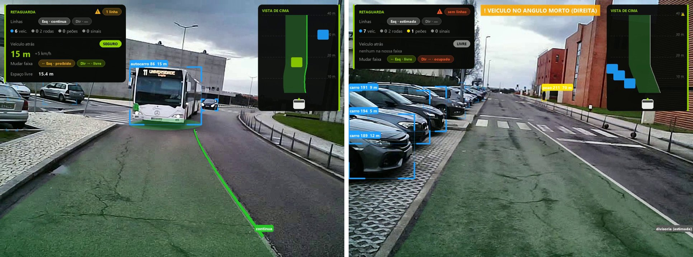
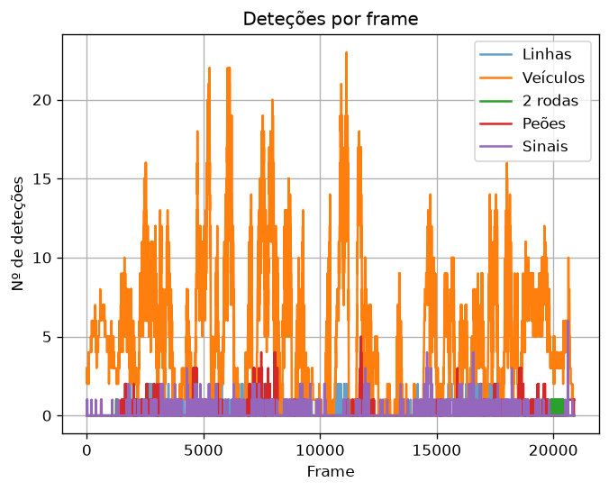
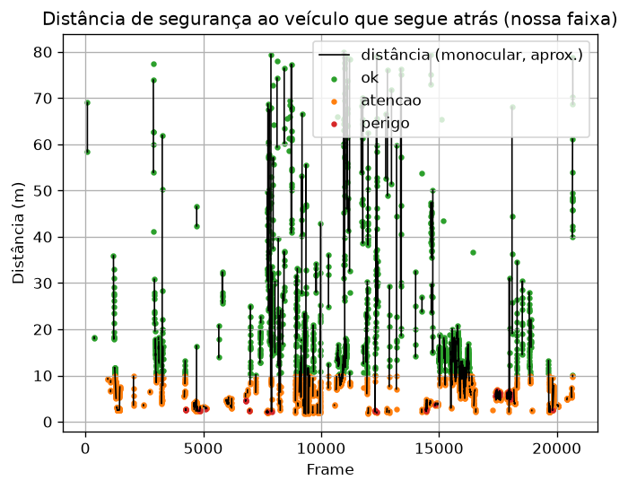

# Perceção visual traseira do ATLASCAR2

**Veículos Autónomos 2026/2027 · Grupo 06** — João Tomás (119137) · Tomás Frade (113507)

Perceção com a câmara traseira (Orbbec Astra Pro) do ATLASCAR2: deteção e seguimento de veículos,
duas rodas e peões; linhas da faixa, passadeiras e linhas de paragem; sinais de trânsito
portugueses; distância e tempo até à colisão; avisos de segurança; grelha de ocupação local atrás
do carro e planeamento local (A*) para avaliar a mudança de faixa. Em ROS 2 e Docker, com uma
aplicação para analisar as gravações fora de linha.


| | |
|---|---|
| **Sensor** | Orbbec Astra Pro (RGB-D), USB; cor 1280×720 a 15 fps (`usb_cam`), profundidade pelo driver Orbbec |
| **Posição no carro** | `camera_tras_link`, traseira, a olhar para trás: x = −0,50 m, y = 0, z ≈ 1,75 m, yaw = π em relação ao `base_link` (valores no `.env`) |
| **Driver ROS 2** | `ros-jazzy-usb-cam` (cor); `OrbbecSDK_ROS2` (profundidade, `Dockerfile.rgbd`) |
| **Saídas** | `/g06/grelha_local`, `/g06/percecao/*`, `/g06/visualizacao/*`, `/g06/reacao/*`, `/g06/caminho_local`, `/g06/estado` |
| **Documentos** | [Plano de projeto](docs/plano_de_projeto_G6.pdf) |

**Conteúdo:** [Arquitetura](#arquitetura) · [Como correr](#como-correr) · [Dados](#dados) ·
[Resultados](#resultados) · [Métodos](#métodos) · [Aplicação fora de linha](#aplicação-fora-de-linha) ·
[Estrutura do repositório](#estrutura-do-repositório) · [Limitações](#limitações-e-trabalho-futuro)

## Arquitetura

```
câmara (real | simulada | bag) --image_raw/compressed--> percecao --grelha_local--> local_astar (A*)
          + URDF (/tf_static)          |                    |  \--percecao/seguranca, agentes--> reacao
                                       |                    |
                                       +--> visualizador <--+  percecao/agentes, pavimento, seguranca
                                              \--> visualizacao/imagem_anotada, marcadores (RViz / Foxglove)
```

O **processamento está separado da visualização**: o nó `percecao` só processa e publica dados; o
nó `visualizador` subscreve a câmara e esses dados, junta as mensagens da mesma imagem pelo
carimbo de tempo e desenha (`va_g06/reconstrucao.py` converte as mensagens no formato do
desenho). O núcleo de processamento (`percecao/pipeline.py`) é o mesmo no ROS 2 e na aplicação
fora de linha.

| Serviço (compose) | Nós | Subscreve | Publica |
|---|---|---|---|
| `camera` (perfil `sensor`) | `usb_cam`, `robot_state_publisher` | — | `/atlascar2/camera_tras/image_raw/compressed`, `/atlascar2/camera_tras/camera_info`, `/tf_static` |
| `simulador` (perfil `simulado`) | `camara_simulada`, `robot_state_publisher` | — | os mesmos tópicos da câmara (vídeo de `data/` ou estrada sintética) |
| `reprodutor` (perfil `reproduzir`) | `ros2 bag play` | — | os tópicos do bag (`TOPICOS` no `.env`) |
| `percecao` | `percecao`, `visualizador`, `reacao` (`va_g06`) | imagem da câmara, `/tf_static`, `/atlascar2/velocidade`, `/atlascar2/pisca`, `/atlascar2/marcha_atras` | tabela seguinte |
| `planeador` | `local_astar` (`va_planeamento`, comum) | `/g06/grelha_local` | `/g06/caminho_local`, `/g06/estado`, `/g06/zona_proibida` |

### Tópicos

| Tópico | Tipo | frame_id | Conteúdo |
|---|---|---|---|
| `/atlascar2/camera_tras/image_raw/compressed` | sensor_msgs/CompressedImage | `camera_tras_optical_frame` | imagem da câmara, 15 Hz (é a que se grava) |
| `/g06/grelha_local` | nav_msgs/OccupancyGrid | `base_link` | grelha de ocupação atrás do carro |
| `/g06/percecao/agentes` | va_percecao_msgs/Agentes | `camera_tras_optical_frame` | veículos, duas rodas, peões e sinais: ID, distância, faixa (lado do carro), TTC |
| `/g06/percecao/deteccoes` | vision_msgs/Detection2DArray | idem | as mesmas caixas em tipos normalizados |
| `/g06/percecao/pavimento` | va_percecao_msgs/Pavimento | idem | linhas da faixa e tipo (com os traços reais das tracejadas), divisória estimada, passadeiras, linhas de paragem |
| `/g06/percecao/seguranca` | va_percecao_msgs/EstadoSeguranca | idem | veículo atrás (distância, TTC), mudança de faixa, espaço livre, avisos |
| `/g06/visualizacao/imagem_anotada/compressed` | sensor_msgs/CompressedImage | idem | imagem com o painel, caixas, faixa e vista de topo (só se alguém subscrever) |
| `/g06/visualizacao/marcadores` | visualization_msgs/MarkerArray | `camera_tras_link` | agentes em 3D |
| `/g06/reacao/acao` | va_percecao_msgs/Acao | idem | nível e comandos (`LIGAR_QUATRO_PISCAS`, `NAO_MUDAR_ESQUERDA`, `PARAR_MARCHA_ATRAS`, …) |
| `/g06/reacao/aviso` | std_msgs/String | — | texto para o condutor (quando muda) |

O driver publica com QoS *best effort* e a perceção subscreve com o mesmo perfil. A perceção trata
sempre a imagem **mais recente**: se o modelo for mais lento do que a câmara, salta imagens em vez
de acumular atraso.

### Grelha local

`/g06/grelha_local`, no `base_link`, com o `header.stamp` da imagem que lhe deu origem; 0,2 m por
célula, x de −35 a 5 m (a câmara vê para trás), y de −10 a 10 m.

| Valor | Significado |
|---|---|
| **100** ocupado | veículos, duas rodas e peões como caixas no chão (pelo modelo monocular de chão plano); linhas contínuas |
| **0** livre | chão visível dentro do campo de visão (66°), até ao primeiro obstáculo ou 30 m; o próprio carro e os 3 m atrás dele |
| **−1** desconhecido | escondido atrás de um veículo, fora do campo de visão ou demasiado longe |

A pose da câmara vem do `/tf_static` (URDF); sem TF usa-se o parâmetro `pose_camara_omissao`.

**Mudança de faixa.** O objetivo do planeador comum é a faixa ao lado, 20 m atrás do carro
(`objetivo_x: -20`, `objetivo_y: 3.5` para a esquerda; −3,5 para a direita), num corredor limitado
à estrada (|y| ≤ 5,25 m). O que a câmara não vê não conta como livre (`desconhecido_livre: false`).
Se o caminho chega à faixa pedida, a mudança é possível; se não chega ou o estado é `BLOQUEADO`, é
insegura. A perceção publica também a decisão direta em `/g06/percecao/seguranca`
(`mudar_esquerda` / `mudar_direita`: livre, ocupado ou proibido por linha contínua).

## Como correr

Requisitos: Docker (Ubuntu 24.04 com Docker Engine, ou Windows com Docker Desktop, sem sensores) e
Git LFS (modelos treinados).

```bash
git clone https://github.com/frad3x/va-percecao-traseira-atlascar2
cd va-percecao-traseira-atlascar2
git lfs pull --include="modelos/*"
docker compose build
docker compose --profile simulado up                        # sem câmara: câmara simulada
docker compose --profile sensor up                          # com a câmara ligada (Linux)
BAG=<pasta_em_data> docker compose --profile reproduzir up  # com um bag gravado
```

- **Visualização:** `--profile foxglove` e, no Foxglove/Lichtblick, `ws://localhost:8765` (painel 3D
  com *Display frame* `base_link`: `/g06/grelha_local`, `/g06/caminho_local`,
  `/g06/visualizacao/marcadores`; painel Image: `/g06/visualizacao/imagem_anotada/compressed`).
  Em Linux também `--profile rviz`.
- **Gravar** a câmara e os resultados em `data/`: juntar `--profile gravar`.
- **Outro tópico de imagem** (por exemplo num bag de outro sistema): `IMAGE_TOPIC` no `.env` e,
  para `sensor_msgs/Image` sem compressão, `COMPRIMIDA=false`; vale para a perceção, a
  visualização e o `--profile reproduzir`, sem reconstruir a imagem.
- **Câmara simulada com um vídeo:** `VIDEO_SIM=/data/<vídeo>.mp4` no `.env`; para um vídeo lado a
  lado (cor | profundidade) também `METADE_SIM=esquerda`.
- **GPU NVIDIA:** `docker compose -f compose.yaml -f compose.gpu.yaml ...`; sem GPU, no `.env`,
  `MODELO=modelos/yolo11n.pt` e `IMGSZ=640`.
- **Windows** (PowerShell): `$env:COMPOSE_FILE = "compose.windows.yaml"` antes dos comandos.
- **Valores ao vivo:** `docker compose exec percecao bash` e `ros2 topic echo /g06/percecao/seguranca`.
- **Desenvolvimento:** VS Code com *Dev Containers* (`.devcontainer/`), `colcon build --symlink-install`.

**Parâmetros que dependem do carro** (`.env` e `src/va_g06/config/`):
- `video_device` e `pixel_format` em `usb_cam.yaml` (`v4l2-ctl --list-devices`; sem imagem,
  `pixel_format: yuyv` com 640×480);
- pose da câmara `CAM_X … CAM_YAW` no `.env` (URDF e grelha) e `altura_camara` em `params.yaml`
  (escala das distâncias);
- intrínsecos em `camera_info.yaml` (opcionais; a perceção não precisa de calibração).

**Profundidade (RGB-D).** A profundidade da Astra Pro sai pelo driver Orbbec, numa imagem à parte:
`docker compose --profile rgbd build camera_rgbd` e `docker compose --profile rgbd up camera_rgbd`.
Converter a profundidade de um bag em nuvens de pontos:
`python -m percecao.profundidade --fonte data/<bag> --saida_dir data/nuvens`.

## Dados

| Gravação (em `data/`) | Data | Conteúdo |
|---|---|---|
| `passeio_20261120_091854/` | 20/11/2026 | **volta real com o ATLASCAR2**: 23 min, 41 804 imagens a 30 fps, cor e profundidade lado a lado (1280×480), e `telemetria.csv` (instante de cada imagem) |
| `g02_camtras_20261104_*_percurso1/` | 04/11/2026 | bags MCAP de teste do sistema de aquisição |
| `passeio_20261104_160353/` | 04/11/2026 | vídeo de teste lado a lado (10 s) |
| `videos_teste/` | — | vídeos de câmaras traseiras usados no desenvolvimento |

As gravações não estão no repositório (vários GB): ficam no disco do grupo.

## Resultados

### Volta real de 20/11/2026



20 902 imagens (a metade a cores, a 15 fps, a taxa da câmara no carro), analisadas com o pipeline
completo. Figuras: `python tools/figura_grelha.py data/passeio_20261120_091854/rgb_camara_traseira.mp4 --instantes 15128 15506 15700`.

| Grandeza | Valor |
|---|---|
| Imagens com as duas linhas da faixa / com pelo menos uma | 6 % / 43 % (ruas urbanas, muitas sem marcas) |
| Veículos / peões / duas rodas por imagem (média) | 5,1 / 0,25 / 0,02 |
| Veículo na nossa faixa atrás do carro | 41 % do tempo (31 % a distância segura, 10 % perto) |
| Mudança de faixa possível (perceção): esquerda / direita | 62 % / 77 % |
| Imagens com algum aviso | 35 % |
| Sinais mais vistos | STOP, contornar pela direita (D3a), lomba (A2a), cedência de passagem (B1), trânsito proibido (C2), paragem e estacionamento proibidos (C16), limites de 50 e 60 km/h |





### Deteção de agentes

`tools/avaliar_volta.py` escolhe 150 imagens espalhadas pela volta e compara as deteções do sistema
com uma **referência independente** (YOLO11x a 1280 px, confiança ≥ 0,5; objetos com ≥ 20 px de
altura, IoU ≥ 0,5). Mede a concordância com esse modelo, não uma anotação manual: para isso,
`python tools/anotar.py` (parte das caixas da referência) e depois
`python tools/avaliar_volta.py <vídeo> --gt resultados/avaliacao_volta/gt_manual.json`.

| Grupo | Precisão | Recall | F1 |
|---|---|---|---|
| Veículos | 0,83 | 0,84 | 0,84 |
| Peões | 0,86 | 0,74 | 0,79 |
| Duas rodas (4 na referência; pouco representativo) | 1,00 | 0,25 | 0,40 |

As discordâncias concentram-se nas filas de carros estacionados, tapados uns pelos outros.

### Sinais (modelos treinados pelo grupo)

| Modelo | Resultado |
|---|---|
| Detetor YOLO11s (GTSDB, 4 categorias) | precisão 0,97 · recall 0,99 · mAP50 0,991 |
| Classificador YOLO11n-cls (GTSRB, 43 tipos) | 97,1 % top-1 |
| Combinação GTSRB + 159 sinais portugueses | 93,9 % em 5 760 fotografias reais; reconhece ~115 sinais que o GTSRB não tem |

### Estabilidade do desenho

Pipeline completo nos 3 primeiros e nos 3 últimos minutos da volta (2 700 imagens cada), sem e com
a estabilização temporal (caixas, tipo e presença das linhas, divisória):

| Grandeza | 3 primeiros min | 3 últimos min |
|---|---|---|
| Tremor das caixas entre imagens (mediana, fração da altura) | 0,075 → 0,038 | 0,059 → 0,035 |
| Caixas que aparecem por minuto | 328 → 155 | 399 → 165 |
| Trocas do tipo da linha por minuto | 7,7 → 2,7 | 1,0 → 1,0 |
| Salto da divisória a 12 m (percentil 90) | 0,25 → 0,16 m | 0,21 → 0,11 m |

O tremor da câmara é pequeno (percentil 90 ≤ 1,4 px); a compensação do tremor e um filtro de Kalman
por linha foram testados e pioravam o alinhamento das linhas com a tinta.

## Métodos

### Modelo da câmara

Pinhole de chão plano, sem padrão de calibração: o campo de visão (66°) e a altura (1,75 m) dão a
escala, o horizonte a inclinação. Nos vídeos 640×480 desta câmara o horizonte é fixo (0,365 da
altura, medido na volta real: a câmara está fixa no carro); nas outras resoluções é estimado pela
mediana do ponto de fuga das retas da imagem (`horizonte_conhecido` em `percecao/linhas.py`).

### Linhas da faixa (`percecao/linhas.py`), método da Aula 5

| Passo | Aula 5 | Aqui |
|---|---|---|
| Vista de topo | `birdsEyeView` | IPM com chão plano |
| Marcas | `segmentLaneMarkerRidge` | ridge simétrico com contraste local (CLAHE) |
| Linhas | `findParabolicLaneBoundaries` | janelas deslizantes e parábolas por RANSAC |
| Rejeição | `validateBoundaryFcn`, `isOfMinLength` | curvatura, comprimento mínimo, força relativa |
| Tipo | `classifyLaneTypes` | contínua / tracejada pela cobertura |
| Faixa do carro | `leftEgoBoundary` / `rightEgoBoundary` | linha mais próxima de cada lado |
| Dashboard (ex. 4b) | triângulos | amarelo com 1 linha, vermelho sem nenhuma |
| Estatística (ex. 4a/4c) | estrutura por imagem | `linhas.csv` |

- **Só tinta:** uma candidata só é linha se for estreita (≤ 0,35 m), mais clara do que o asfalto
  dos **dois** lados (afasta bermas, calçada e riscas de passadeira) e organizada em traços de pelo
  menos 1,2 m. As barras das passadeiras e linhas de paragem saem da procura.
- **No tempo:** cada linha é procurada perto de onde estava; uma posição muito diferente só é aceite
  se se repetir em 5 imagens (mudança de faixa real). O tipo só muda quando o outro ocupa 70 % das
  últimas 15 imagens; uma linha confirmada esbate-se quando deixa de ser vista.
- **Tracejadas:** desenhadas só nos traços que existem.
- **Sem linhas pintadas:** divisória estimada a partir do asfalto segmentado, sempre à esquerda do
  carro (circula-se pela direita); com o carro em calçada não se estima.

| Vídeo de teste | Duas linhas | Tipo certo (esq. / dir.) |
|---|---|---|
| Estrada de montanha com curvas | 99 % | 92 % / 99 % |
| Autoestrada com sol de frente | 97 % | 98 % / 99,5 % |

### Agentes, distância e TTC

YOLO11m (COCO) a 1280 px com rastreio ByteTrack: veículos, duas rodas (o condutor fundido na caixa)
e peões. A distância vem da base da caixa no modelo de chão plano; o tempo até à colisão, do
crescimento da caixa (*looming*), só depois de 3 medições seguidas a crescer pelo menos 5 %/s e
ignorando caixas cortadas pela borda. **Perigo** só com TTC ≤ 1 s; para mudar de faixa, um veículo
ao lado com TTC ≤ 4 s já torna a manobra insegura. Sem GPU: `yolo11n.pt` a 640 px.

O desenho usa caixas estabilizadas no tempo (`percecao/estabilizar.py`: previsão a velocidade
constante, confirmação e memória curta); os dados, as mensagens e as métricas usam as caixas
medidas.

### Sinais

1. **Detetor** YOLO11s treinado no GTSDB (4 categorias).
2. **Classificador** YOLO11n-cls treinado no GTSRB (43 tipos, fotografias reais).
3. **Classificador português** YOLO11n-cls com os 159 sinais A/B/C/D do Regulamento de Sinalização
   do Trânsito (`treino/sinais_pt.py`), treinado com imagens sintéticas geradas a partir dos
   desenhos oficiais do Wikimedia Commons (créditos em `va_datasets/sinais_pt/creditos.csv`).

Nos tipos que o GTSRB conhece decide o GTSRB; nos restantes, o classificador português (confiança
≥ 0,80). Sem os modelos treinados fica um detetor clássico por cor e forma (`percecao/sinais.py`).
Treinar de novo: `python treino/treinar_sinais.py` e `python treino/sinais_pt.py`.

### Apoio ao estacionamento (RGB-D)

`python -m percecao.percecao3d`: plano do chão por RANSAC, obstáculos por DBSCAN e espaço livre
na retaguarda (Open3D), a partir das nuvens de pontos da profundidade.

## Aplicação fora de linha

O mesmo núcleo corre sem ROS nem Docker (Windows ou Linux, Python 3.12) para analisar gravações:
vídeo, pasta de imagens ou bag MCAP.

- **Janela:** `python -m percecao.gui` (ou o atalho criado com `python tools/criar_atalho.py`).
- **`main.py`:** escolher `FONTE` no bloco de configuração e executar.
- **Linha de comandos:** `python -m percecao data/<bag ou vídeo>` (`--help` para as opções).

Cada análise fica em `resultados/<gravação>_<data>/`: `deteccoes.csv`, `linhas.csv`,
`seguranca.csv`, gráficos e, se pedido, o vídeo anotado. No leitor: **espaço** reproduzir/pausa,
**A/D** recuar/avançar, **+/−** velocidade, **G** guias de estacionamento, **V** vista de topo,
**Q** sair. Dependências em `requirements.txt` (`pip install ".[app]"`).

## Estrutura do repositório

| Pasta / ficheiro | Conteúdo |
|---|---|
| `Dockerfile`, `compose*.yaml`, `.env` | imagem e serviços (estrutura do modelo da Aula 10) |
| `Dockerfile.rgbd` | imagem do driver de profundidade da Orbbec |
| `src/va_g06/` | nós `percecao`, `visualizador`, `reacao`, `camara_simulada`; launch; URDF da câmara; `config/` |
| `src/va_percecao_msgs/` | mensagens do grupo (`Agentes`, `Pavimento`, `EstadoSeguranca`, `Acao`, …) |
| `src/va_planeamento/` | grelha local e A* comuns a todos os grupos (sem alterações) |
| `percecao/` | núcleo de processamento e aplicação fora de linha |
| `main.py` | ponto de entrada da aplicação fora de linha |
| `modelos/` | modelos de sinais treinados pelo grupo (Git LFS); os YOLO base descarregam-se automaticamente |
| `treino/` | treino dos modelos de sinais |
| `tools/` | métricas na volta real (`avaliar_volta.py`), anotação manual (`anotar.py`), figuras, atalho da aplicação |
| `va_datasets/` | desenhos dos sinais portugueses (com créditos) e métricas dos treinos; GTSRB, GTSDB e Argoverse descarregam-se com `treino/dados_sinais.py` e `tools/descarregar_argoverse.py` |
| `docs/` | plano de projeto e figuras do README |
| `.github/workflows/ci.yml` | integração contínua: constrói a imagem e corre os testes |

## Limitações e trabalho futuro

- A distância é monocular (chão plano, horizonte fixo): serve para níveis de risco e erra em
  subidas e descidas. O horizonte foi medido na gravação a 640×480; falta medi-lo para o fluxo a
  1280×720 do `usb_cam` (até lá, estimado ou fixado em `linhas_params`).
- Os carros estacionados ainda não se distinguem dos que circulam: perto deles disparam avisos de
  ângulo morto e de veículo atrás.
- A volta foi gravada em vídeo; a próxima recolha deve ser em MCAP (`--profile gravar`), com a
  profundidade, o `/tf_static` e a velocidade do carro.
- As métricas de deteção na volta são em relação a um modelo de referência; falta uma anotação
  manual.
- O classificador português foi treinado com imagens sintéticas; a 640×480 os sinais ao longe têm
  poucos píxeis.
